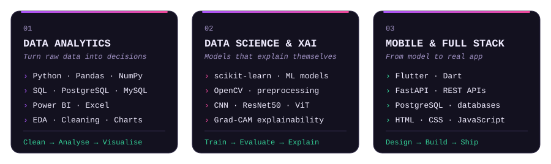

<!--
 HOW TO EDIT THIS PROFILE
 1. Search this file for personal details you want to update.
 2. The visual cards live in the assets folder. Open any .svg and change its text.
 3. Colours: #a855f7 purple, #ec4899 pink, #34d399 green, #0b0a12 background.
 4. Each section is separate, so you can delete or reorder one at a time.
-->

<p align="center">
  
</p>

<p align="center">
  <a href="https://github.com/BeniSpec/BenSpec_ProfessionalPortfolio_1"></a>
  <a href="https://www.linkedin.com/in/benat-siraj-ahmed"></a>
  <a href="mailto:benatsiraj83@gmail.com"></a>
  <a href="https://www.instagram.com/beni_au1/"></a>
</p>

<p align="center"></p>

<p align="center">
  
</p>

<h2 align="center">💡 About Me</h2>

<p align="center">
I turn raw data into decisions, and decisions into mobile apps people actually use.<br/>
I'm a Computer Science student who enjoys the full data-to-product journey:<br/>
collecting and cleaning data, analysing it, building models, and shipping them inside real applications.
</p>

```text
$ cat now.txt

building    FingerBlood · an explainable-AI mobile app (Flutter + FastAPI + OpenCV + Grad-CAM)
interning   [EDIT: company] · [EDIT: what you do there]
learning    Power BI dashboards · SQL optimisation · ML deployment
open to     data / app internships · collaboration · mentoring
```

<p align="center"></p>

<h2 align="center">🎯 What I Focus On</h2>

<p align="center">
  
</p>

<h2 align="center">🛠️ Tech Stack</h2>

<!-- EDIT: keep only the icons for tools you can discuss in an interview -->
<p align="center">
  
  <br/><br/>
  
  <br/><br/>
  
</p>

<p align="center"></p>
